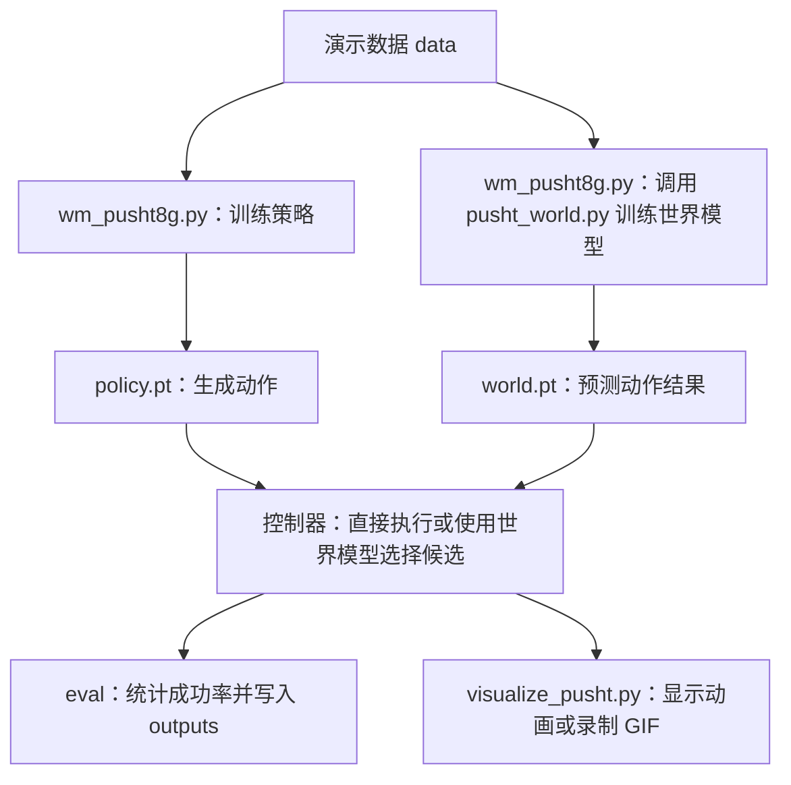

# PushT 项目目录指南

本指南根据 E:/WorldM8g 当前实际文件、代码入口、权重元信息及评估记录整理。整理时未移动、删除文件或改变训练代码。数据分片、Python 缓存和 Git 内部文件按同类解释，其余项目文件逐项列出。

## 先理解整个项目

这是一个使用低维状态输入的 PushT 实验：策略学习“该做什么动作”，世界模型学习“动作会产生什么后果”。训练策略和训练世界模型是两项独立任务，世界模型辅助推理时再组合使用。



本指南同时记录本机保留的历史和论文工作文件；数据、论文临时资料及部分历史实验副本未纳入 Git，因此克隆仓库后的文件数量会少于这里的本机清单。两组世界模型 runs_world 与 runs_world_manual 的权重、日志和摘要已随本次更新纳入 Git。

日常优先看 README、wm_pusht8g.py、pusht_world.py、visualize_pusht.py，以及自己指定的模型输出目录。文件名带 v2 的脚本是旧实验，不是当前推荐入口。

## 根目录：代码、说明和配置

| 文件／目录 | 作用 |
|---|---|
| [wm_pusht8g.py](wm_pusht8g.py) | 当前主入口。检查环境、下载/读取数据、训练扩散策略、调用世界模型训练、加载权重、执行仿真评估；包含策略网络 Denoiser 和共用控制器 ChunkController。 |
| [pusht_world.py](pusht_world.py) | 新版世界模型模块。历史窗口数据集、多步动力学网络、模型集成、完整验证、可靠性阈值、T 形覆盖率计算、候选动作评分。通常由主入口调用，不单独运行。 |
| [visualize_pusht.py](visualize_pusht.py) | 当前动画入口。加载策略及可选世界模型，打开仿真窗口或保存 GIF；与评估共用控制器。它不训练模型。 |
| [wm_pusht8g_v2.py](wm_pusht8g_v2.py) | 早期 v2 独立实验脚本：小型 MLP 策略、余弦扩散日程、旧单步世界模型。默认模型目录为 runs_v2，保留用于旧版本对照。 |
| [visualize_pusht_v2.py](visualize_pusht_v2.py) | 配套 v2 脚本的动画程序。需要复现 v2 行为时才使用。 |
| [test_pusht.py](test_pusht.py) | 策略及控制器回归测试：噪声日程、采样公式、角度与几何、数据窗口、动作队列、旧权重和网络反向传播。 |
| [test_world.py](test_world.py) | 世界模型测试：历史动作对齐、回合隔离、角度周期、多步预测、环境覆盖率、回退机制、随机数一致性、验证及权重加载。 |
| [README.md](README.md) | 项目使用说明：环境安装、训练、评估、动画与世界模型参数。遇到如何运行的问题先看这里。 |
| [RESULTS.md](RESULTS.md) | 2026-10-18 的策略改进报告。记录旧策略与改进策略的 50 局对照、训练设置和修复点。文中的“没有重新训练世界模型”只描述该历史实验。 |
| [WORLD_MODEL_RESULTS.md](WORLD_MODEL_RESULTS.md) | 2026-10-21 的世界模型辅助报告。对应 runs_world 的 4,000 次更新模型，而非后来的手动模型；包含预测误差及 20 局实际成功率对照。 |
| [requirements.txt](requirements.txt) | Python 依赖版本清单。PyTorch 按硬件另行安装；此文件不是训练参数配置。 |
| [.gitignore](.gitignore) | 规定哪些本地文件不纳入 Git，例如数据、实验副本、论文临时资料、缓存。被忽略不等于已删除。 |
| [.gitattributes](.gitattributes) | 规定代码文本的换行方式，并标记权重、图片、PDF 等二进制文件。 |
| [PROJECT_GUIDE.md](PROJECT_GUIDE.md) | 本文件：目录用途与文件关系索引。 |

## 如何定位要修改的功能

| 想修改的内容 | 从哪里看 |
|---|---|
| 策略网络结构、去噪和动作生成 | wm_pusht8g.py 的 Denoiser、TemporalUNet |
| 演示数据读取、训练窗口 | wm_pusht8g.py 的 load_arrays、WindowDataset |
| 世界模型历史长度、多步预测和训练损失 | pusht_world.py 的 RolloutDataset、HistoryDynamics、train_ensemble |
| 世界模型候选评分和回退条件 | pusht_world.py 的 rank_candidates |
| 连续执行几步、历史与动作队列 | wm_pusht8g.py 的 ChunkController |
| 成功率统计、评估 JSON | wm_pusht8g.py 的 evaluate |
| 动画、GIF、录制频率 | visualize_pusht.py 的 run |

## 模型目录：.pt 是训练结果，不是代码

策略模型 `policy.pt` 用来生成动作；世界模型 `world.pt` 用来预测动作结果，二者不能互换。新版训练中，不带 last 的文件按验证集误差选优，带 last 的文件保存最后一次训练结果；“验证最优”并不保证实际成功率最高。旧版权重不应一律套用这个命名规则。

### runs

最早的策略基线。

| 文件／目录 | 作用 |
|---|---|
| [runs/policy.pt](runs/policy.pt) | 策略权重。 旧版训练 30,000 次，预测 8 步动作。 |

### runs_v2

早期 v2 策略实验。

| 文件／目录 | 作用 |
|---|---|
| [runs_v2/policy.pt](runs_v2/policy.pt) | 策略权重。 版本标记为 2，训练 30,000 次，预测 8 步。 |

### runs_improved

当前默认策略目录。

| 文件／目录 | 作用 |
|---|---|
| [runs_improved/policy.pt](runs_improved/policy.pt) | 策略权重。 U-Net、预测 16 步动作；选自 30,000 次训练过程中的第 10,000 次更新。 |
| [runs_improved/policy_last.pt](runs_improved/policy_last.pt) | 最后训练阶段保存的策略 EMA 权重。 对应第 30,000 次更新。 |
| [runs_improved/training_summary.json](runs_improved/training_summary.json) | 策略训练配置、模型选择与结果元信息。 |

### runs_improved_epsilon

中间实验：残差 MLP 与 epsilon（噪声）预测。

| 文件／目录 | 作用 |
|---|---|
| [runs_improved_epsilon/policy.pt](runs_improved_epsilon/policy.pt) | 策略权重。 |
| [runs_improved_epsilon/policy_last.pt](runs_improved_epsilon/policy_last.pt) | 最后训练阶段保存的策略 EMA 权重。 |

### runs_improved_velocity

中间实验：残差 MLP 与 v-prediction；velocity 指扩散预测参数化，不是“给小球增加速度传感器”。

| 文件／目录 | 作用 |
|---|---|
| [runs_improved_velocity/policy.pt](runs_improved_velocity/policy.pt) | 策略权重。 |
| [runs_improved_velocity/policy_last.pt](runs_improved_velocity/policy_last.pt) | 最后训练阶段保存的策略 EMA 权重。 |

### runs_improved_geometry

中间实验：加入 T 形几何特征的 MLP。

| 文件／目录 | 作用 |
|---|---|
| [runs_improved_geometry/policy.pt](runs_improved_geometry/policy.pt) | 策略权重。 |
| [runs_improved_geometry/policy_last.pt](runs_improved_geometry/policy_last.pt) | 最后训练阶段保存的策略 EMA 权重。 |

### runs_improved_unet

时序 U-Net 策略的原始训练输出目录。

| 文件／目录 | 作用 |
|---|---|
| [runs_improved_unet/policy.pt](runs_improved_unet/policy.pt) | 策略权重。 U-Net、预测 16 步动作；选自 30,000 次训练过程中的第 10,000 次更新。 |
| [runs_improved_unet/policy_last.pt](runs_improved_unet/policy_last.pt) | 最后训练阶段保存的策略 EMA 权重。 对应第 30,000 次更新。 |

### runs_world

本次已评估的世界模型：4,000 次更新，3 个成员、4 帧历史、4 步预测。

| 文件／目录 | 作用 |
|---|---|
| [runs_world/world.pt](runs_world/world.pt) | 完整验证集上误差最小的世界模型权重，包含集成网络及可靠性阈值。 |
| [runs_world/world_last.pt](runs_world/world_last.pt) | 最后一次更新的世界模型权重及阈值。 |
| [runs_world/world_metrics.jsonl](runs_world/world_metrics.jsonl) | 训练日志：每行一个记录点，包含更新次数、训练损失和验证误差。适合绘制学习曲线。 |
| [runs_world/world_summary.json](runs_world/world_summary.json) | 训练摘要：结构、数据划分、选中更新次数、逐步预测误差和阈值。 |

### runs_world_manual

手动训练的独立世界模型目录。当前摘要记录 20,000 次更新、学习率 0.0004，选中权重也来自第 20,000 次更新。

| 文件／目录 | 作用 |
|---|---|
| [runs_world_manual/world.pt](runs_world_manual/world.pt) | 完整验证集上误差最小的世界模型权重，包含集成网络及可靠性阈值。 |
| [runs_world_manual/world_last.pt](runs_world_manual/world_last.pt) | 最后一次更新的世界模型权重及阈值。 |
| [runs_world_manual/world_metrics.jsonl](runs_world_manual/world_metrics.jsonl) | 训练日志：每行一个记录点，包含更新次数、训练损失和验证误差。适合绘制学习曲线。 |
| [runs_world_manual/world_summary.json](runs_world_manual/world_summary.json) | 训练摘要：结构、数据划分、选中更新次数、逐步预测误差和阈值。 |

已核对文件内容：runs_improved 与 runs_improved_unet 中同名的两个策略权重分别完全相同，前者是默认使用位置，后者保留实验来源。

手动模型不会因为训练次数更多就自动替代已有模型。当前代码的默认输出目录是 runs_improved；使用 runs_world 或 runs_world_manual 中的世界模型时，需要显式传入 `--world-checkpoint`。当前目录中未发现手动 20,000 次模型对应的独立成功率报告，不能把旧 4,000 次模型的评估结果当成它的结果。

## data：训练用的专家演示

| 文件／目录 | 作用 |
|---|---|
| [data/pusht.zip](data/pusht.zip) | 下载的原始数据压缩包。解压后的 Zarr 数据用于当前训练。 |
| [data/pusht/pusht_cchi_v7_replay.zarr](data/pusht/pusht_cchi_v7_replay.zarr) | 真正的数据集目录。虽然名称以 .zarr 结尾，它是由元信息与数据分块组成的文件夹。 |

| 文件／目录 | 作用 |
|---|---|
| [data/pusht/pusht_cchi_v7_replay.zarr/data/state](data/pusht/pusht_cchi_v7_replay.zarr/data/state) | 25,650 × 5：小球 x/y、T 字 x/y/角度。当前策略和世界模型训练直接读取。 |
| [data/pusht/pusht_cchi_v7_replay.zarr/data/action](data/pusht/pusht_cchi_v7_replay.zarr/data/action) | 25,650 × 2：演示动作，即小球的目标坐标。当前训练直接读取。 |
| [data/pusht/pusht_cchi_v7_replay.zarr/meta/episode_ends](data/pusht/pusht_cchi_v7_replay.zarr/meta/episode_ends) | 206 个回合结束位置，用于划分轨迹、训练/验证集合，防止窗口跨回合。当前训练直接读取。 |
| [data/pusht/pusht_cchi_v7_replay.zarr/data/img](data/pusht/pusht_cchi_v7_replay.zarr/data/img) | 25,650 × 96 × 96 × 3：图像数据。当前状态输入版本不读取它。 |
| [data/pusht/pusht_cchi_v7_replay.zarr/data/keypoint](data/pusht/pusht_cchi_v7_replay.zarr/data/keypoint) | 25,650 × 9 × 2：关键点坐标。当前版本不直接读取，策略几何特征由状态另行计算。 |
| [data/pusht/pusht_cchi_v7_replay.zarr/data/n_contacts](data/pusht/pusht_cchi_v7_replay.zarr/data/n_contacts) | 25,650 × 1：接触数量记录。当前版本不直接读取；可用于将来分析接触阶段。 |

Zarr 内部自动文件的含义：

| 名称或模式 | 作用 |
|---|---|
| `.zgroup` | 标记一个数据分组。 |
| `.zattrs` | 分组或数组的附加属性。 |
| `.zarray` | 数组尺寸、数据类型、分块和压缩方式。 |
| `0.0`、`1.0` 等 | state、action、n_contacts 的数组数据块。 |
| `0.0.0` 等 | keypoint 数组的数据块。 |
| `0.0.0.0` 等 | img 数组的数据块。 |
| episode_ends 下的 `0` | 回合结束位置数组的数据块。 |

数字文件不是单独一局或单独一个实验。它们由 Zarr 库按元信息拼接读取，不需要逐个打开或编辑。这里共有 206 条演示轨迹、25,650 帧数据。

## outputs：评估报告和动画

JSON 保存实验结果，GIF/PNG 保存可视化。这里没有正式训练数据，也不是默认模型加载目录。旧报告中的 checkpoint 路径可能是当时共用的保存位置，之后该路径的权重已更换；应同时检查报告中的 training、种子和对应实验记录。

| 文件／目录 | 作用 |
|---|---|
| [outputs/baseline_final50.json](outputs/baseline_final50.json) | 旧策略最终 50 局基线，种子 30000–30049，0/50；从旧控制台结果整理。 |
| [outputs/final_holdout50.json](outputs/final_holdout50.json) | 当前改进 U-Net 的最终 50 局报告，同组种子，30/50；对应 RESULTS.md。 |
| [outputs/improved_holdout50.json](outputs/improved_holdout50.json) | 历史几何 MLP 的 50 局报告，种子 20000–20049，0/50；虽然名字叫 improved，却不是当前默认 U-Net 的最终报告。 |
| [outputs/improved_interim_eval.json](outputs/improved_interim_eval.json) | 早期改进策略的中途 10 局评估，记录该阶段效果，不代表现有默认权重。 |
| [outputs/epsilon_final_eval.json](outputs/epsilon_final_eval.json) | epsilon 预测方案的历史 10 局评估。 |
| [outputs/geometry_development_eval.json](outputs/geometry_development_eval.json) | 几何特征 MLP 在开发种子上的 10 局评估。 |
| [outputs/velocity_interim_eval.json](outputs/velocity_interim_eval.json) | v-prediction MLP 的中途 10 局评估。 |
| [outputs/velocity_final_eval.json](outputs/velocity_final_eval.json) | v-prediction MLP 的最终阶段 10 局评估。 |
| [outputs/velocity_action8_eval.json](outputs/velocity_action8_eval.json) | v-prediction MLP 每次连续执行 8 步的对照。 |
| [outputs/unet_interim_eval.json](outputs/unet_interim_eval.json) | U-Net 训练中途的 10 局评估。 |
| [outputs/unet_best_development.json](outputs/unet_best_development.json) | U-Net 选中权重、每次执行 4 步的开发集结果。 |
| [outputs/unet_action8_development.json](outputs/unet_action8_development.json) | U-Net 每次执行 8 步的开发集对照。 |
| [outputs/synthetic_pipeline_check.json](outputs/synthetic_pipeline_check.json) | 合成数据策略的短流程测试，只检查程序能否跑通，不用于证明任务性能。 |
| [outputs/world_dev_policy10.json](outputs/world_dev_policy10.json) | 世界模型实验的开发组原策略对照：10 局、种子 40000 起、4/10。 |
| [outputs/world_dev_assisted10.json](outputs/world_dev_assisted10.json) | 同开发组世界模型辅助结果：2/10，包含候选选择与回退记录。 |
| [outputs/world_holdout_policy20.json](outputs/world_holdout_policy20.json) | 世界模型实验的独立 20 局原策略基线：种子 50000 起、8/20。 |
| [outputs/world_holdout_assisted20.json](outputs/world_holdout_assisted20.json) | 同组 20 局、4,000 次更新世界模型辅助结果：5/20，含决策日志。 |
| [outputs/world_comparison.json](outputs/world_comparison.json) | 上述世界模型开发/最终对照的汇总与逐局成对成功计数。 |
| [outputs/world_prediction_audit.json](outputs/world_prediction_audit.json) | 世界模型预测误差审计：全部窗口、实际移动窗口，以及假设 T 字静止的参照。 |
| [outputs/world_sampling_control1.json](outputs/world_sampling_control1.json) | 种子 40000 的采样控制实验：生成额外候选但只执行第一个，核对与原策略的一致性。 |
| [outputs/world_experiment_manifest.json](outputs/world_experiment_manifest.json) | 4,000 次世界模型实验的环境版本、训练/评估参数及模型/代码指纹。代码后来变化时，指纹用于辨认当时版本。 |
| [outputs/improved_seed42.gif](outputs/improved_seed42.gif) | 历史改进策略在 seed 42 的演示动画，不能仅凭名称认定是当前默认权重。 |
| [outputs/improved_seed42_final.png](outputs/improved_seed42_final.png) | 上一条 seed 42 动画的末帧截图。 |
| [outputs/improved_success_example.gif](outputs/improved_success_example.gif) | 改进策略的成功示例动画；RESULTS.md 记录为种子 10002、199 步成功。 |
| [outputs/improved_success_final.png](outputs/improved_success_final.png) | 成功示例的末帧截图。 |
| [outputs/unet_interim_seed42.gif](outputs/unet_interim_seed42.gif) | U-Net 中途权重在 seed 42 的动画。 |

### outputs/test_checkpoints：仅用于检查程序的合成数据产物

| 文件／目录 | 作用 |
|---|---|
| [outputs/test_checkpoints/synthetic_debug/policy.pt](outputs/test_checkpoints/synthetic_debug/policy.pt) | 合成数据训练选出的调试策略权重。 |
| [outputs/test_checkpoints/synthetic_debug/policy_last.pt](outputs/test_checkpoints/synthetic_debug/policy_last.pt) | 合成数据最后一次更新的策略权重。 |
| [outputs/test_checkpoints/synthetic_debug/training_metrics.jsonl](outputs/test_checkpoints/synthetic_debug/training_metrics.jsonl) | 合成策略训练的损失日志。 |
| [outputs/test_checkpoints/world/smoke.gif](outputs/test_checkpoints/world/smoke.gif) | 合成世界模型短运行的录制检查动画。 |
| [outputs/test_checkpoints/world/smoke_eval.json](outputs/test_checkpoints/world/smoke_eval.json) | 重新加载合成世界模型后，在真实环境中短运行的流程检查。 |
| [outputs/test_checkpoints/world/synthetic_debug/world.pt](outputs/test_checkpoints/world/synthetic_debug/world.pt) | 合成数据训练选出的调试世界模型。 |
| [outputs/test_checkpoints/world/synthetic_debug/world_last.pt](outputs/test_checkpoints/world/synthetic_debug/world_last.pt) | 合成世界模型最后一次更新权重。 |
| [outputs/test_checkpoints/world/synthetic_debug/world_metrics.jsonl](outputs/test_checkpoints/world/synthetic_debug/world_metrics.jsonl) | 合成世界模型训练日志。 |
| [outputs/test_checkpoints/world/synthetic_debug/world_summary.json](outputs/test_checkpoints/world/synthetic_debug/world_summary.json) | 合成世界模型配置、误差与阈值摘要。 |

## backups/before_improvement：改进前的历史快照

用于追溯和复现原版。备份文件不会被当前入口自动调用。

| 文件／目录 | 作用 |
|---|---|
| [backups/before_improvement/baseline_eval.txt](backups/before_improvement/baseline_eval.txt) | 原版 10 局评估的控制台文本。 |
| [backups/before_improvement/baseline_final50.txt](backups/before_improvement/baseline_final50.txt) | 原版最终 50 局对照文本；与 outputs/baseline_final50.json 对应。 |
| [backups/before_improvement/baseline_holdout50.txt](backups/before_improvement/baseline_holdout50.txt) | 原版早期 50 局留出评估的控制台文本。 |
| [backups/before_improvement/README.md](backups/before_improvement/README.md) | 改进前的说明书；其中路径与操作仅适用于旧版本。 |
| [backups/before_improvement/v2_eval.txt](backups/before_improvement/v2_eval.txt) | 早期 v2 的 10 局评估控制台文本。 |
| [backups/before_improvement/visualize_pusht.py](backups/before_improvement/visualize_pusht.py) | 改进前的动画程序。 |
| [backups/before_improvement/wm_pusht8g.py](backups/before_improvement/wm_pusht8g.py) | 改进前的训练、采样与评估代码，可用于复现原始基线控制行为。 |

## paper_readings：论文原文与精读工作文件

这些文件用于阅读论文，不参与 PushT 模型训练。sources 是原始资料/文字提取，work 是阅读稿、页面图片和处理脚本。当前 work 中有 5 份 Markdown 精读工作稿；没有发现第 6 篇 Consistency Policy 的 Markdown 稿，也没有发现最终 Word 文档。工作稿的存在不代表内容已经完成最终核验。

论文编号对应：01 DPPO、02 DRIFT、03 DINO-WM、04 Feedback World Model、05 Streaming Flow Policy、06 Consistency Policy。

### sources 中每个文件

| 文件／目录 | 作用 |
|---|---|
| [paper_readings/sources/01_DPPO.json](paper_readings/sources/01_DPPO.json) | 从 PDF 按页提取的文本列表，不是模型配置或实验成绩。 |
| [paper_readings/sources/01_DPPO.pdf](paper_readings/sources/01_DPPO.pdf) | 下载的论文 PDF 原文。 |
| [paper_readings/sources/01_DPPO.txt](paper_readings/sources/01_DPPO.txt) | 按页合并的可搜索纯文本，不保留完整图表版式。 |
| [paper_readings/sources/02_DRIFT.json](paper_readings/sources/02_DRIFT.json) | 从 PDF 按页提取的文本列表，不是模型配置或实验成绩。 已核对：该来源未提取出正文，JSON 为 15 个空字符串，TXT 仅有页码；阅读应改看 PDF 或 arXiv 来源。 |
| [paper_readings/sources/02_DRIFT.pdf](paper_readings/sources/02_DRIFT.pdf) | 下载的论文 PDF 原文。 |
| [paper_readings/sources/02_DRIFT.txt](paper_readings/sources/02_DRIFT.txt) | 按页合并的可搜索纯文本，不保留完整图表版式。 已核对：该来源未提取出正文，JSON 为 15 个空字符串，TXT 仅有页码；阅读应改看 PDF 或 arXiv 来源。 |
| [paper_readings/sources/02_DRIFT_arxiv.json](paper_readings/sources/02_DRIFT_arxiv.json) | 从 PDF 按页提取的文本列表，不是模型配置或实验成绩。 DRIFT 的 arXiv 补充来源版本。 |
| [paper_readings/sources/02_DRIFT_arxiv.pdf](paper_readings/sources/02_DRIFT_arxiv.pdf) | 下载的论文 PDF 原文。 DRIFT 的 arXiv 补充来源版本。 |
| [paper_readings/sources/03_DINO_WM.json](paper_readings/sources/03_DINO_WM.json) | 从 PDF 按页提取的文本列表，不是模型配置或实验成绩。 |
| [paper_readings/sources/03_DINO_WM.pdf](paper_readings/sources/03_DINO_WM.pdf) | 下载的论文 PDF 原文。 |
| [paper_readings/sources/03_DINO_WM.txt](paper_readings/sources/03_DINO_WM.txt) | 按页合并的可搜索纯文本，不保留完整图表版式。 |
| [paper_readings/sources/04_Feedback_WM.json](paper_readings/sources/04_Feedback_WM.json) | 从 PDF 按页提取的文本列表，不是模型配置或实验成绩。 |
| [paper_readings/sources/04_Feedback_WM.pdf](paper_readings/sources/04_Feedback_WM.pdf) | 下载的论文 PDF 原文。 |
| [paper_readings/sources/05_Streaming_Flow.json](paper_readings/sources/05_Streaming_Flow.json) | 从 PDF 按页提取的文本列表，不是模型配置或实验成绩。 |
| [paper_readings/sources/05_Streaming_Flow.pdf](paper_readings/sources/05_Streaming_Flow.pdf) | 下载的论文 PDF 原文。 |
| [paper_readings/sources/06_Consistency_Policy.json](paper_readings/sources/06_Consistency_Policy.json) | 从 PDF 按页提取的文本列表，不是模型配置或实验成绩。 |
| [paper_readings/sources/06_Consistency_Policy.pdf](paper_readings/sources/06_Consistency_Policy.pdf) | 下载的论文 PDF 原文。 |
| [paper_readings/sources/06_Consistency_Policy.txt](paper_readings/sources/06_Consistency_Policy.txt) | 按页合并的可搜索纯文本，不保留完整图表版式。 |

### work 中每个文件

| 文件／目录 | 作用 |
|---|---|
| [paper_readings/work/01_DPPO.md](paper_readings/work/01_DPPO.md) | 论文精读 Markdown 工作稿：用强化学习继续改进扩散策略。 |
| [paper_readings/work/01_DPPO_p4.png](paper_readings/work/01_DPPO_p4.png) | 论文 PDF 第 4 页的渲染图片；这里是 PDF 页码，不一定等于正文印刷页码。 |
| [paper_readings/work/01_DPPO_p8.png](paper_readings/work/01_DPPO_p8.png) | 论文 PDF 第 8 页的渲染图片；这里是 PDF 页码，不一定等于正文印刷页码。 |
| [paper_readings/work/01_DPPO_p9.png](paper_readings/work/01_DPPO_p9.png) | 论文 PDF 第 9 页的渲染图片；这里是 PDF 页码，不一定等于正文印刷页码。 |
| [paper_readings/work/01_DPPO_source_review.png](paper_readings/work/01_DPPO_source_review.png) | 多个论文页面的拼接预览图，供阅读/核对图表使用。 |
| [paper_readings/work/02_DRIFT.md](paper_readings/work/02_DRIFT.md) | 论文精读 Markdown 工作稿：用专家纠错和动态秩调整改进扩散策略。 |
| [paper_readings/work/02_DRIFT_arxiv_p5.png](paper_readings/work/02_DRIFT_arxiv_p5.png) | 论文 PDF 第 5 页的渲染图片；这里是 PDF 页码，不一定等于正文印刷页码。 |
| [paper_readings/work/02_DRIFT_arxiv_p7.png](paper_readings/work/02_DRIFT_arxiv_p7.png) | 论文 PDF 第 7 页的渲染图片；这里是 PDF 页码，不一定等于正文印刷页码。 |
| [paper_readings/work/02_DRIFT_arxiv_p9.png](paper_readings/work/02_DRIFT_arxiv_p9.png) | 论文 PDF 第 9 页的渲染图片；这里是 PDF 页码，不一定等于正文印刷页码。 |
| [paper_readings/work/02_DRIFT_arxiv_source_review.png](paper_readings/work/02_DRIFT_arxiv_source_review.png) | 多个论文页面的拼接预览图，供阅读/核对图表使用。 |
| [paper_readings/work/03_DINO_WM.md](paper_readings/work/03_DINO_WM.md) | 论文精读 Markdown 工作稿：在视觉特征中预测未来并规划动作。 |
| [paper_readings/work/03_DINO_WM_p4.png](paper_readings/work/03_DINO_WM_p4.png) | 论文 PDF 第 4 页的渲染图片；这里是 PDF 页码，不一定等于正文印刷页码。 |
| [paper_readings/work/03_DINO_WM_p6.png](paper_readings/work/03_DINO_WM_p6.png) | 论文 PDF 第 6 页的渲染图片；这里是 PDF 页码，不一定等于正文印刷页码。 |
| [paper_readings/work/03_DINO_WM_p9.png](paper_readings/work/03_DINO_WM_p9.png) | 论文 PDF 第 9 页的渲染图片；这里是 PDF 页码，不一定等于正文印刷页码。 |
| [paper_readings/work/03_DINO_WM_source_review.png](paper_readings/work/03_DINO_WM_source_review.png) | 多个论文页面的拼接预览图，供阅读/核对图表使用。 |
| [paper_readings/work/04_Feedback_WM.md](paper_readings/work/04_Feedback_WM.md) | 论文精读 Markdown 工作稿：用实际观察纠正预测并引导扩散动作。 |
| [paper_readings/work/04_Feedback_WM_p10.png](paper_readings/work/04_Feedback_WM_p10.png) | 论文 PDF 第 10 页的渲染图片；这里是 PDF 页码，不一定等于正文印刷页码。 |
| [paper_readings/work/04_Feedback_WM_p5.png](paper_readings/work/04_Feedback_WM_p5.png) | 论文 PDF 第 5 页的渲染图片；这里是 PDF 页码，不一定等于正文印刷页码。 |
| [paper_readings/work/04_Feedback_WM_p8.png](paper_readings/work/04_Feedback_WM_p8.png) | 论文 PDF 第 8 页的渲染图片；这里是 PDF 页码，不一定等于正文印刷页码。 |
| [paper_readings/work/04_Feedback_WM_source_review.png](paper_readings/work/04_Feedback_WM_source_review.png) | 多个论文页面的拼接预览图，供阅读/核对图表使用。 |
| [paper_readings/work/05_Streaming_Flow.md](paper_readings/work/05_Streaming_Flow.md) | 论文精读 Markdown 工作稿：让动作在生成过程中逐步执行。 |
| [paper_readings/work/05_Streaming_Flow_p10.png](paper_readings/work/05_Streaming_Flow_p10.png) | 论文 PDF 第 10 页的渲染图片；这里是 PDF 页码，不一定等于正文印刷页码。 |
| [paper_readings/work/05_Streaming_Flow_p2.png](paper_readings/work/05_Streaming_Flow_p2.png) | 论文 PDF 第 2 页的渲染图片；这里是 PDF 页码，不一定等于正文印刷页码。 |
| [paper_readings/work/05_Streaming_Flow_p7.png](paper_readings/work/05_Streaming_Flow_p7.png) | 论文 PDF 第 7 页的渲染图片；这里是 PDF 页码，不一定等于正文印刷页码。 |
| [paper_readings/work/05_Streaming_Flow_source_review.png](paper_readings/work/05_Streaming_Flow_source_review.png) | 多个论文页面的拼接预览图，供阅读/核对图表使用。 |
| [paper_readings/work/06_Consistency_Policy_p4.png](paper_readings/work/06_Consistency_Policy_p4.png) | 论文 PDF 第 4 页的渲染图片；这里是 PDF 页码，不一定等于正文印刷页码。 |
| [paper_readings/work/06_Consistency_Policy_p6.png](paper_readings/work/06_Consistency_Policy_p6.png) | 论文 PDF 第 6 页的渲染图片；这里是 PDF 页码，不一定等于正文印刷页码。 |
| [paper_readings/work/06_Consistency_Policy_p8.png](paper_readings/work/06_Consistency_Policy_p8.png) | 论文 PDF 第 8 页的渲染图片；这里是 PDF 页码，不一定等于正文印刷页码。 |
| [paper_readings/work/06_Consistency_Policy_source_review.png](paper_readings/work/06_Consistency_Policy_source_review.png) | 多个论文页面的拼接预览图，供阅读/核对图表使用。 |
| [paper_readings/work/fetch_papers.py](paper_readings/work/fetch_papers.py) | 下载预设论文 PDF，并提取逐页 JSON 和 TXT；为论文资料处理脚本，与训练无关。 |
| [paper_readings/work/inspect_sources.py](paper_readings/work/inspect_sources.py) | 把指定 PDF 页面渲染为 PNG，并生成多页拼接图，用于检查论文图表。 |

## 自动维护目录

| 文件／目录 | 作用 |
|---|---|
| [.git](.git) | Git 版本历史与本地仓库元信息。objects 存版本对象，refs/HEAD 记录版本指向，index 记录暂存状态，logs 记录引用变化，config 是仓库配置；通常交给 Git 管理，不需要逐个编辑。 |
| [__pycache__](__pycache__) | Python 自动生成的 .pyc 字节码缓存。每个文件对应被导入过的模块及 Python 版本，不是源代码或训练权重。 |
| [pip_temp](pip_temp) | 安装依赖时使用的临时目录。本次检查为空，不参与训练和评估。 |

## 容易混淆的地方

1. `wm_pusht8g.py` 是当前入口；带 `_v2` 的脚本是旧版。
2. `policy.pt` 决定如何行动，`world.pt` 预测行动结果；训练世界模型不会自动改变策略权重。
3. `policy_last.pt` / `world_last.pt` 是最后保存的权重，不一定比验证集选出的权重好。
4. `runs_world_manual` 当前是 20,000 次更新模型，已有世界模型对照报告属于 `runs_world` 的 4,000 次更新模型。
5. `improved_holdout50.json` 是历史几何 MLP 结果；当前 U-Net 的 50 局结果应看 `final_holdout50.json`。
6. `runs_improved_velocity` 的 velocity 对应扩散 v-prediction，不能据此判断模型使用了物理速度输入。
7. `.json` 通常是配置或结果，`.jsonl` 是逐行日志，`.pt` 是模型权重，`.md` 是说明文档，`.gif/.png` 是可视化。
8. 训练损失下降、验证误差下降和任务成功率提高是三件不同的事，分别查看训练日志、验证摘要和实际评估报告。

## 你目前最常用的操作

在终端进入 E:/WorldM8g 并激活已有环境后：

```powershell
# 查看原策略动画：默认加载 runs_improved/policy.pt
python visualize_pusht.py --mode policy --device cpu

# 用你手动训练的世界模型辅助原策略
python visualize_pusht.py --mode world --device cpu --world-checkpoint runs_world_manual/world.pt

# 评估手动模型并生成新的结果文件
python wm_pusht8g.py eval --device cpu --mode world --world-checkpoint runs_world_manual/world.pt --episodes 20 --seed 60000 --report outputs/manual_world20.json

# 同种子原策略对照
python wm_pusht8g.py eval --device cpu --mode policy --episodes 20 --seed 60000 --report outputs/manual_policy20.json

# 运行代码检查
python -m unittest test_pusht test_world -v
```

上述 manual_world20.json 与 manual_policy20.json 是运行命令后才会生成的新文件，编写本指南时尚未发现它们。需要新训练时，在 README 的命令基础上指定新的 `--out-dir` 保存实验，避免不同训练混用同名权重与报告。
